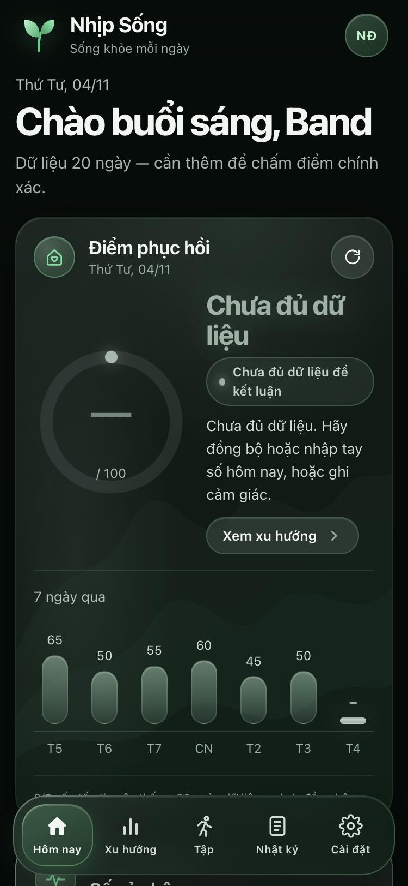
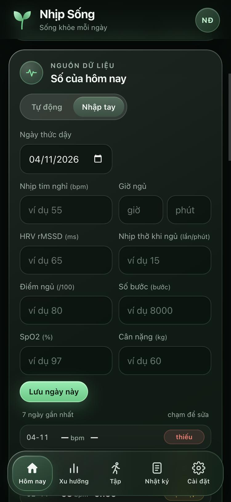
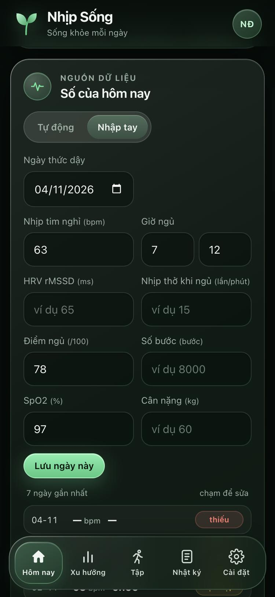
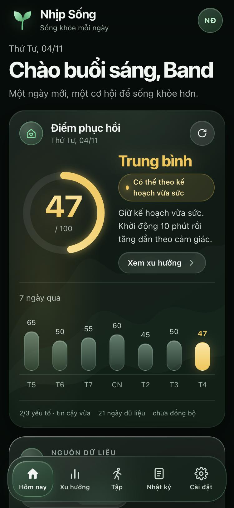
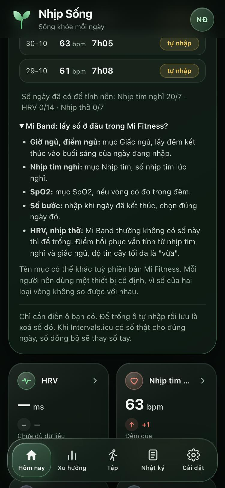

# Nhịp Sống

Ứng dụng web cho cả nhà xem mỗi sáng: **hôm nay cơ thể hồi phục tới đâu và nên làm gì**. App chạy trên một máy Mac trong nhà, mọi người mở bằng trình duyệt trên điện thoại. Dữ liệu nằm trên máy của bạn.

Có hai cách đưa số vào app: **tự động** từ Intervals.icu (ví dụ HUAWEI Watch), hoặc **nhập tay** từ app của vòng đeo (ví dụ Mi Band). Không có số từ Intervals.icu thì vẫn nhập tay được và có kết luận ngay.

> Đây **không phải WHOOP** và **không phải thiết bị y tế**. Điểm 0–100 là chỉ số tham khảo có công thức công khai, tính theo mức nền của chính bạn. Cảm giác của bạn luôn được ưu tiên hơn số đồng hồ.


*Mọi ảnh trong README đều chụp từ dữ liệu giả, không phải dữ liệu sức khoẻ thật.*

## Tính năng

| Nhóm | App làm được gì |
| --- | --- |
| **Buổi sáng** | Điểm hồi phục 0–100 và một hành động cụ thể cho hôm nay: giữ kế hoạch, giảm tải, ưu tiên hồi phục hoặc nghỉ |
| **Minh bạch** | Thẻ *Vì sao điểm này?* nêu từng yếu tố, số điểm đóng góp, phần còn thiếu và mức tin cậy |
| **Nguồn dữ liệu** | Hai mục *Tự động* và *Nhập tay*. Số đồng bộ thật sẽ thay số tay khi về sau |
| **Nhập tay** | Nhịp tim nghỉ, giờ ngủ, HRV, nhịp thở, điểm ngủ, số bước, SpO2, cân nặng. Quản trị ghi được cho người nhà |
| **Giấc ngủ** | So với nhu cầu của bạn, có kế hoạch tối nay cần ngủ bao nhiêu |
| **Vận động** | Danh sách buổi tập và mục tiêu tải tuần theo mức hồi phục |
| **Cảnh báo** | Nhịp thở tăng cùng nhịp tim nghỉ tăng hoặc HRV giảm thì chặn điểm ở 50. Báo triệu chứng nặng thì ẩn điểm và nhắc gọi 115 |
| **Xu hướng** | Biểu đồ 7, 30, 90 ngày và mức nền cá nhân. Đánh dấu được số sai để loại khỏi nền |
| **Nhật ký** | Ghi cảm giác và thói quen hằng ngày |
| **Gia đình** | Mỗi người một tài khoản, dữ liệu tách riêng. Quản trị thấy các số trong form nhập tay của thành viên để nhập hộ, nhưng không xem được điểm, nhật ký hay buổi tập của họ |
| **Riêng tư** | Không cần dịch vụ đám mây của app. API key được mã hoá, có sao lưu, nhập CSV, không cần cài thư viện npm |


## Bắt đầu nhanh

Cần **Node.js 22.5 trở lên**. Người trong nhà chỉ cần trình duyệt, không phải cài gì.

```bash
git clone https://github.com/hydennguyen86-code/nhip-song.git
```

```bash
cd nhip-song
```

```bash
bash scripts/nhip start
```

Lệnh sẽ in địa chỉ để mở trên Mac và trên điện thoại. Lần đầu mở, app yêu cầu **tạo tài khoản quản trị**. Sau đó vào **Cài đặt → Quản lý gia đình** để tạo tài khoản cho từng người.

**Muốn xem thử bằng dữ liệu giả, không đụng dữ liệu thật:**

```bash
NHIP_DATA_DIR=./demo-data node scripts/seed-demo.mjs
```

```bash
PORT=8901 NHIP_DATA_DIR=./demo-data node server/index.mjs
```

Mở `http://127.0.0.1:8901`, đăng nhập bằng `admin`, `demo` hoặc `miband`, mật khẩu `demo-1234`. Xong thì xoá thư mục `demo-data`.

## Người đeo Mi Band: làm từng bước

Mi Band không đồng bộ được sang Intervals.icu, nên bạn chép số từ app **Mi Fitness** sang Nhịp Sống. Mỗi sáng mất khoảng một phút.

**Chuẩn bị (làm một lần):**

1. Nhờ người quản trị tạo tài khoản cho bạn trong app.
2. Mở địa chỉ app trên điện thoại, đăng nhập và đổi mật khẩu.
3. Trong Safari, chọn *Chia sẻ → Thêm vào MH chính* để mở nhanh như một ứng dụng.
4. Trong Mi Fitness, bật theo dõi giấc ngủ và nhịp tim liên tục.

**Mỗi sáng:**

| 1. Sáng ra, chưa có số | 2. Mở mục Nhập tay | 3. Chép số từ Mi Fitness | 4. Xem kết luận |
| --- | --- | --- | --- |
|  |  |  |  |

Bấm **Lưu ngày này** là điểm tính lại ngay. Chỉ điền ô bạn có:

| Ô trong app | Lấy ở đâu trong Mi Fitness | Bắt buộc? |
| --- | --- | --- |
| Nhịp tim nghỉ | Mục Nhịp tim, số lúc nghỉ | **Nên có**, tính 25% điểm |
| Giờ ngủ | Mục Giấc ngủ, đêm kết thúc vào sáng hôm đó | **Nên có**, tính 30% điểm |
| Điểm ngủ | Mục Giấc ngủ | Không |
| SpO2 | Mục SpO2, nếu vòng có đo trong đêm | Không |
| Số bước | Mục Bước chân, nhập khi ngày đã kết thúc và chọn đúng ngày đó | Không |
| Cân nặng | Cân của bạn | Không |
| HRV, nhịp thở | Thường không có trên Mi Band, để trống | Không |

Tên mục có thể khác tuỳ phiên bản Mi Fitness. Trong app, mục *Mi Band: lấy số ở đâu trong Mi Fitness?* nhắc lại bảng này.

**Nên biết:**

- **Lần đầu, nhập bù ít nhất 7 ngày trước.** App cần 7 ngày để biết nhịp tim nghỉ bình thường của bạn. Chạm vào từng dòng ngày để nhập, tối đa 30 ngày.
- **Điểm kém chắc hơn khi không có HRV.** Các bài đánh giá ghi Band 9 và 9 Pro không có HRV, nên điểm tính từ nhịp tim nghỉ và giấc ngủ, độ tin cậy tối đa là "vừa".
- **Nên dùng một thiết bị cố định.** Số của hai loại vòng không so được với nhau, đeo lẫn sẽ làm sai mức nền.
- **Quên nhập cũng không sao.** Điểm hôm đó chưa có, các ngày khác không bị ảnh hưởng.

| Người quản trị nhập hộ | Hướng dẫn ngay trong app | Mục Tự động khi còn thiếu số |
| --- | --- | --- |
|  |  |  |

---

## 1. Chạy lần đầu trên Mac

Xem [Bắt đầu nhanh](#bắt-đầu-nhanh) ở trên. Lệnh start in ra:

- URL trên chính Mac: `http://127.0.0.1:8899`
- URL cho iPhone cùng Wi-Fi: `http://192.168.x.x:8899` (đọc từ `ipconfig getifaddr en0`)
- URL qua Tailscale nếu máy có cài ([mục 18](#18-truy-cập-từ-xa-bằng-tailscale-tuỳ-chọn))

Nếu Node không có sẵn:

```bash
brew install node
```

Node nằm ngoài `PATH` thì đặt `NHIP_NODE` trỏ tới file chạy `node`.

Với HUAWEI Watch, dữ liệu đi theo đường HUAWEI Health → Intervals.icu, và HRV qua Health Sync. App **chỉ đọc**, không bao giờ sửa hoặc xoá dữ liệu trên Intervals.icu.

## 2. Lệnh vận hành

| Lệnh | Ý nghĩa |
| --- | --- |
| `bash scripts/nhip start` | Khởi động app (chạy nền) |
| `bash scripts/nhip stop` | Dừng |
| `bash scripts/nhip restart` | Dừng rồi chạy lại |
| `bash scripts/nhip status` | Đang chạy? in `/api/health` |
| `bash scripts/nhip logs [N]` | Xem N dòng log cuối (mặc định 80) |
| `bash scripts/nhip test` | Chạy bộ test unit |
| `bash scripts/nhip seed` | Nạp dữ liệu giả để xem UI |
| `bash scripts/nhip backup` | Sao lưu database + secret.key sang `backups/` |

Bật lại sau khi Mac khởi động: thêm `bash <thư-mục-app>/scripts/nhip start` vào *System Settings → General → Login Items* (dạng script, dùng Shortcut app hoặc launchagent tuỳ bạn). Không cần cài lại gì, dữ liệu nằm trong `data/`.

## 3. Tạo tài khoản

**Lần chạy đầu, chưa có ai** → app tự hiện form tạo admin. Điền tên đăng nhập (chữ thường, 3–32 ký tự), tên hiển thị và mật khẩu (≥ 6 ký tự, số cũng được).

**Thêm người nhà**: admin đăng nhập → tab **Cài đặt** → phần *Quản lý gia đình* → nhập tên đăng nhập, tên hiển thị và mật khẩu tạm. Người nhà mở app bằng URL LAN, đăng nhập bằng mật khẩu tạm, **app bắt buộc đổi mật khẩu lần đầu**.

Admin **không** mặc định xem được điểm, nhật ký hay buổi tập của thành viên. Mọi endpoint trả dữ liệu đều lọc theo user_id của phiên đăng nhập. Ngoại lệ duy nhất là thẻ nhập tay: admin chọn được người ở ô *Ghi cho* để nhập hộ, nên thấy 30 ngày gần nhất của 8 chỉ số trong form đó. Tính năng chia sẻ chủ động (người sở hữu cho phép rồi thu hồi) để ở giai đoạn sau.

## 4. Kết nối Intervals.icu cho từng người

Mỗi người tự làm 4 bước này, **không gửi key cho ai** (kể cả qua chat):

1. Mở `https://intervals.icu/settings` bằng tài khoản Intervals.icu của chính mình.
2. Kéo xuống cuối trang, mục **Developer Settings** — ở đó có **API Key** (chuỗi ~25 ký tự) và **Athlete ID**. Copy cả hai.
3. Ghi nhớ **Athlete ID** (dạng `i123456`, thấy ở cùng trang).
4. Trong app Nhịp Sống, tab **Cài đặt → Kết nối Intervals.icu**, dán Athlete ID và API key → bấm **Lưu và thử kết nối**.

App sẽ gọi `GET /api/v1/athlete/{id}` để xác minh key. Key lưu trong SQLite đã mã hoá **AES-256-GCM**, với khoá nằm ở `data/secret.key` (quyền 0600, `.gitignore`). Key không bao giờ ghi ra log, không nằm trong frontend, không nằm trong backup JSON.

Đồng bộ kéo `wellness` và `activities` theo khoảng ngày; lần đầu lấy 120 ngày để có đủ 30 ngày nền.

## 5. Đồng bộ

- **Thủ công**: nút *Đồng bộ ngay* trong thẻ *Số của hôm nay*, mục *Tự động*.
- **Tự động**: admin đặt giờ (mặc định **06:30 Asia/Ho_Chi_Minh**) trong tab Cài đặt. Máy Mac phải bật và app phải chạy thì lịch mới kích hoạt.
- Sync lỗi (key sai, timeout, rate limit) → hiển thị thông báo nhưng **giữ nguyên dữ liệu cũ**.

### Tự động hay nhập tay

Buổi sáng không phải chờ Intervals.icu. Trang **Hôm nay** có thẻ **Số của hôm nay** với hai mục, người dùng tự chọn. Mỗi máy nhớ lựa chọn riêng; chưa chọn thì có kết nối Intervals.icu sẽ mở **Tự động**, chưa có sẽ mở **Nhập tay**.

- **Tự động**: hiện số hôm nay đã có và số còn thiếu (nhịp tim nghỉ, giấc ngủ, thêm HRV nếu người đó có HRV). Còn thiếu thì app tự hỏi Intervals.icu khi mở trang, tối đa 15 phút một lần, và có nút *Nhập tay phần thiếu*.
- **Nhập tay**: điền cả ngày trên một form. Kết luận buổi sáng tính lại ngay sau khi lưu.

Dù chọn mục nào, khi Intervals.icu có số thật cho đúng ngày, **số thật thay số tay**.

HUAWEI Health không xuất HRV và nhịp thở, còn Mi Band không đồng bộ được sang Intervals.icu. Form nhập tay gồm:

| Chỉ số | Đơn vị, khoảng nhận | App dùng vào |
| --- | --- | --- |
| Nhịp tim nghỉ | 30–110 bpm | Điểm hồi phục (25%), cần ≥ 7 ngày nền |
| Giờ ngủ | giờ + phút, tối đa 16 giờ | Điểm hồi phục (30%) |
| HRV rMSSD | 1–300 ms | Điểm hồi phục (45%), cần ≥ 14 ngày nền. Không nhập SDNN |
| Nhịp thở khi ngủ | 6–30 lần/phút | Chỉ là cờ cảnh báo, cần ≥ 7 đêm nền |
| Điểm ngủ | 0–100 | Hiển thị, xu hướng |
| Số bước | số nguyên | Hiển thị, xu hướng |
| SpO2 | 70–100% | Xu hướng |
| Cân nặng | 20–300 kg | Xu hướng |

Quy tắc:

- Chọn **ngày thức dậy** rồi chỉ điền ô bạn có. Một ô sai thì cả form không lưu.
- Tài khoản **quản trị** chọn người ở ô **Ghi cho**. Thành viên thường chỉ ghi cho chính mình. Có thể nhập bù tối đa 30 ngày.
- Số tay vào ngay điểm hồi phục và mức nền. Để trống ô `tự nhập` rồi lưu là xoá số đó; số đồng bộ không bị đụng tới.
- Sync trả `null` thì số tay được giữ. Sync hoặc CSV có số thật cho đúng ngày thì **số thật thay số tay**.

Người đeo Mi Band xem [hướng dẫn từng bước](#người-đeo-mi-band-làm-từng-bước) ở đầu trang.

## 6. Nhập CSV (nếu chưa muốn đồng bộ API)

Intervals.icu cho phép xuất CSV:

- Wellness CSV: *Settings → Export → Wellness CSV*
- Activities CSV: menu *Activities → Download CSV*

Trong app: tab **Cài đặt → Nhập CSV** → chọn file → bấm *Xem trước & nhập*. App hiển thị **số dòng hợp lệ và khoảng ngày**; chỉ ghi vào DB khi bạn bấm *Xác nhận nhập*. Ngày / activity ID trùng sẽ **cập nhật** (không tạo bản sao). Trường trống trong CSV **không** xoá dữ liệu cũ.

### Nguồn khác nhau về cùng một ngày

Đã gặp: HUAWEI Health hiển thị 5h31, bảng Intervals cũ hiện 28 phút, Wellness CSV ghi 5h59. App **không tự chọn một số làm sự thật**. Cách xử lý:

1. Vào tab **Mức nền** hoặc trang Xu hướng.
2. Bấm dòng ngày bất ổn → *Đánh dấu là sai* và chọn trường (sleep_secs, hrv_rmssd, …).
3. Trường bị đánh dấu sẽ bị loại khỏi phép tính mức nền, nhưng **bản gốc vẫn nằm trong `raw_json`**. Huỷ đánh dấu bất cứ lúc nào.

## 7. Màn hình hôm nay

Trang **Hôm nay** trả lời ba câu: hôm nay nên làm gì, vì sao, và cần ngủ bao nhiêu.

### 7.1 Chỉ số hồi phục 0–100 (công thức công khai, v2 — 30/10/2026)

Vòng lớn ở giữa là **chỉ số hồi phục tham khảo**, không phải điểm WHOOP. Mô hình từng tín hiệu nằm trong `server/signals.mjs`, phép cộng điểm trong `server/recovery.mjs`:

| Thành phần | Trọng số | Cách tính |
| --- | --- | --- |
| HRV rMSSD (hoặc SDNN nếu chưa đủ rMSSD) | 45% | **ln(rMSSD)**. 60% đêm qua + 40% trung bình 7 ngày, z so với **trung vị 60 ngày** (độ lệch = 1,4826 × MAD, sàn 0,07 ≈ 7%). Báo vùng **SWC** = nền ± 0,5 độ lệch và **CV 7 ngày** (cảnh báo khi ≥ 1,5 × CV thường lệ). |
| Nhịp tim nghỉ | 25% | đêm qua so với **trung vị 30 ngày**, độ lệch MAD (sàn 1 bpm); **đảo dấu** vì cao hơn là xấu |
| Giấc ngủ | 30% | **so với nhu cầu, không so với trung bình của bạn**: % = ngủ / nhu cầu. Nhu cầu = nền (TB 30 đêm, kẹp 7h30–8h30; < 7 đêm thì 8h) + 20% nợ ngủ 7 đêm trước (tối đa 60 phút) + tối đa 45 phút nếu hôm qua tập nhiều hơn TB 28 ngày. 85% nhu cầu = 50 điểm; mỗi 10% ≈ 22 điểm. |
| Nhịp thở | **0%** | **Cờ cảnh báo một chiều**, không cộng điểm. Bật khi đêm qua cao hơn trung vị 30 đêm ≥ max(1,5; 2 × độ lệch) lần/phút. Thở chậm hơn **không** được cộng điểm. Chưa có số → hiện "chưa có số", **không** hạ độ tin cậy. Có thể nhập tay từ HUAWEI Health ở thẻ *Số của hôm nay*, mục *Nhập tay*. |

Mỗi phần đổi thành điểm con `50 + z × 22`, kẹp 2–99 (giấc ngủ: `50 + (% − 0,85) × 220`). Điểm cuối là trung bình có trọng số; thiếu phần nào thì **chia lại trọng số** và hạ độ tin cậy (3/3 = cao, 2 = vừa, 1 = thấp; HRV còn "sơ bộ" < 28 ngày thì tối đa "vừa"). Dải màu: **67–100 sẵn sàng**, **34–66 trung bình**, **0–33 cần hồi phục**.

**Mẫu hình ốm**: nhịp thở tăng **cùng lúc** với nhịp tim nghỉ tăng (z ≥ 1) hoặc HRV giảm (z ≤ −1) → điểm bị chặn ở 50 và kết luận buổi sáng ít nhất là "ưu tiên hồi phục".

**Làm sạch nền**: giá trị vô lý (ngủ < 3h hoặc > 14h, RHR ngoài 30–110, HRV ngoài 5–250 ms, nhịp thở ngoài 6–30) và **ngày bạn báo "đang bệnh"** không vào mức nền. Đêm ngủ < 3h của *hôm nay* vẫn được tính (có thể là thức trắng thật) nhưng có ghi chú "nếu là lỗi đồng bộ, hãy đánh dấu sai".

Vì sao đổi (v1 → v2):
- v1 so giấc ngủ với trung bình của chính bạn, nên thiếu ngủ kéo dài trông "bình thường". v2 so với nhu cầu nên thấy được khoản thiếu này.
- v1 tính nhịp thở 10% kể cả khi không có dữ liệu, nên độ tin cậy có thể kẹt ở 3/4.
- v1 dùng trung bình 7 ngày HRV làm "hôm nay", nên một đêm rất thấp gần như không đổi điểm.

Vì sao nhịp thở không cộng điểm (tra PubMed, 4/11/2026):
- Bằng chứng mạnh nhất là **phát hiện bệnh**, chủ yếu nghiên cứu COVID-19, không phải đo mức hồi phục. Nhịp thở ban đêm tăng được ghi nhận trước và trong khi có triệu chứng ([Miller 2020](https://doi.org/10.1371/journal.pone.0243693), [Risch 2022](https://doi.org/10.1136/bmjopen-2021-058274)). Tổng quan hệ thống cho thấy độ chính xác dao động lớn, AUC 0,52–0,92, và nhịp tim là dấu hiệu được báo nhiều nhất ([Mitratza 2022](https://doi.org/10.1016/S2589-7500(22)00019-X)).
- Chưa tìm thấy nghiên cứu cho thấy thêm nhịp thở vào điểm hồi phục giúp dự đoán tốt hơn. Nghiên cứu vận động viên gần nhất chỉ là phân cụm mô tả 17 người ([Foucaud 2025](https://doi.org/10.3389/fspor.2025.1629924)).
- Sai số số trung bình cả đêm từ cổ tay khoảng 0,65–1,1 lần/phút ([Natarajan 2021](https://doi.org/10.1038/s41746-021-00493-6), [Jung 2023](https://doi.org/10.3390/s23187976)), nên ngưỡng cờ là +1,5 thay vì +1,0. Mức "tăng mạnh" bắt đầu từ +3, đúng mức Natarajan dùng. Đây là lựa chọn thiết kế, chưa kiểm trên dữ liệu thật của gia đình.
- Dễ báo nhầm: nhịp thở còn đổi theo căng thẳng, nóng, lạnh, gắng sức ([Nicolò 2020](https://doi.org/10.3390/s20216396)) và theo chu kỳ kinh nguyệt ([Goodale 2019](https://doi.org/10.2196/13404)). Vì vậy một mình nhịp thở chỉ tính là 1 cảnh báo; phải đi cùng nhịp tim nghỉ tăng hoặc HRV giảm mới chặn điểm.

Cảm giác chủ quan luôn thắng: báo **đang bệnh** → điểm tối đa 30; **mệt / ngủ kém** → tối đa 50; báo triệu chứng nặng → **ẩn điểm** và hiện cảnh báo gọi 115. Khi mức chặn thực sự làm giảm điểm, app hiện cả **điểm thô** và **điểm sau chặn** (ví dụ 63 → 50) để không che mất dữ liệu.

Thẻ **Vì sao điểm này?** liệt kê từng yếu tố: giá trị, nền, z-score, điểm con, số điểm đóng góp và lý do thiếu. Tổng đóng góp xấp xỉ `điểm − 50` trước khi bị chặn bởi cảm giác. Lịch sử 30 ngày được tô màu theo dải để thấy xu hướng, không chỉ một con số.

### 7.2 Kết luận và hành động

Năm mức kết luận, cộng cấp cứu:

| Kết luận | Khi nào |
| --- | --- |
| **NGƯNG TẬP — cần hỗ trợ y tế** | Người dùng báo đau ngực, khó thở rõ, ngất hoặc gần ngất. App hiện số 115 và **không** gợi ý "sẵn sàng tập". |
| **Hôm nay nên nghỉ hoàn toàn** | Báo "đang bệnh", hoặc ≥ 2 chỉ số xấu rõ rệt (RHR z > 2, HRV z < −2, ngủ < 70% nhu cầu, nhịp thở tăng mạnh), hoặc ≥ 3 cảnh báo. |
| **Nên ưu tiên hồi phục** | Báo "mệt / ngủ kém", hoặc ≥ 2 chỉ số xấu hơn nền. |
| **Nên giảm nhẹ giáo án** | 1 chỉ số lệch nền. |
| **Có thể theo kế hoạch vừa sức** | Các chỉ số trong khoảng nền. |
| **Chưa đủ dữ liệu để kết luận** | Không có đủ RHR / HRV / ngủ để so. |

Mỗi kết luận đi kèm **một hành động cụ thể cho hôm nay** (giữ kế hoạch, giảm 20–30%, chỉ vận động nhẹ, hoặc nghỉ hoàn toàn), không chỉ là nhãn màu.

Ngưỡng z (mặc định 1.0 cho RHR/HRV, 2.0 cho mức "rõ rệt") chỉnh được trong Cài đặt → **Ngưỡng gợi ý buổi sáng**; có thể tắt từng chỉ số. Giấc ngủ dùng ngưỡng cố định: < 85% nhu cầu = cảnh báo, < 70% = rõ rệt. Chỉ **hướng xấu** của một chỉ số mới được tính là cảnh báo (HRV cao bất thường không còn bị đếm là "lệch rõ rệt"). Nhịp thở tăng ≥ 1,5 lần/phút = 1 cảnh báo; tăng kèm RHR tăng hoặc HRV giảm = "ưu tiên hồi phục".

Thẻ hôm nay luôn hiển thị:

- Ngày và **giờ đồng bộ gần nhất** (dữ liệu sáng nay hay cũ).
- Danh sách *Vì sao* — mỗi dòng ghi rõ chỉ số nào so với mức nền nào, bao nhiêu ngày nền.
- Danh sách *Thiếu* — chỉ số nào chưa có, chưa đủ ngày, hay chưa đồng bộ.
- Nút *Đồng bộ ngay* và các nút *Bình thường / Mệt / Bệnh / Nặng*.
- Cảm giác của bạn **luôn thắng** kết luận từ đồng hồ.

### 7.3 Kế hoạch ngủ — Peak / Perform / Get By

Ba mức thời lượng ngủ cho đêm nay, giống cấu trúc Sleep Planner của WHOOP nhưng tính từ dữ liệu của bạn:

- **Nền** = trung bình ngủ 30 ngày, kẹp trong 7h30–8h30 để không đẩy ai vào mục tiêu phi thực tế.
- **Nợ ngủ** 7 đêm gần nhất, trả dần — tối đa khoảng 1 giờ cộng thêm cho một đêm.
- **Điều chỉnh theo tập luyện**: hôm qua tập nhiều hơn trung bình 28 ngày → cộng thêm tối đa 45 phút.
- **Get By** = tối thiểu để tỉnh táo; **Perform** = hồi phục tốt; **Peak** = đỉnh phong độ.
- Giờ đi ngủ được tính ngược từ **giờ thức** bạn đặt trên máy (lưu trong `localStorage`), không gửi lên server.

Giới hạn: `sleepSecs` là tổng thời gian ngủ, không có cấu trúc giấc ngủ; tập sức mạnh/bơi/yoga có thể bị đếm thiếu phút.

### 7.4 Mục tiêu tải tuần

Tải 7 ngày gần nhất chia cho trung bình tuần 28 ngày, hiển thị theo %:

- Hồi phục xanh: **90–125%** — tải vừa đến cao.
- Hồi phục vàng: **50–85%** — tải nhẹ đến vừa.
- Hồi phục đỏ: **0–45%** — ưu tiên hồi phục.

Tải dùng `icu_training_load`; app nói rõ đây không phải thước đo đầy đủ cho tập sức mạnh, bơi hay yoga.

### 7.5 Nhật ký và thói quen

Mỗi buổi sáng ghi cảm giác (bình thường / mệt / bệnh / triệu chứng nặng) và gắn thói quen tối qua: rượu, cà phê sau 14h, tập sau 19h, căng thẳng, ăn muộn, ốm.

Sau khi một thói quen có **≥ 3 ngày** và có **≥ 3 ngày không có** thói quen đó, app so sánh điểm hồi phục **sáng hôm sau** giữa hai nhóm. Kết quả là mô tả ("thấp hơn trung bình X điểm"), **không phải quan hệ nhân quả**; app ghi rõ giới hạn này. Mẫu chưa đủ sẽ hiện tiến độ `2/3` thay vì bịa kết luận.

## 8. Mức nền — cách tính thật

| Chỉ số | Cách tính trong app | Ghi chú |
| --- | --- | --- |
| **RHR** | **Trung vị** + độ lệch MAD của 30 ngày hợp lệ **trước** ngày đang đánh giá (loại ngày báo ốm, giá trị ngoài 30–110) | Ngày đang đánh giá không tự tính vào mức nền của chính nó. |
| **HRV rMSSD** | ln(rMSSD); nền **60 ngày**, cần ≥ 14 ngày cùng loại (14–27 = "sơ bộ", ≥ 28 = "ổn định"); trung vị + MAD. So sánh: 60% đêm qua + 40% TB 7 ngày (≥ 3 ngày); kèm SWC và CV 7 ngày. | Không bao giờ trộn rMSSD và SDNN. Sàn độ lệch 7% để một đêm nhiễu không gây báo động giả. |
| **HRV SDNN** | Tương tự, tách biệt với rMSSD | Ghi rõ số ngày đang có. |
| **Ngủ** | Trung bình phút/đêm 30 ngày (loại đêm < 3h) — chỉ dùng để đặt **nền nhu cầu** 7h30–8h30, không dùng làm chuẩn so sánh | `sleepSecs` có thể gồm ngủ trưa; app nêu rõ giới hạn này. |
| **Nhịp thở** | Trung vị 30 đêm, cần ≥ 7 đêm | Cờ cảnh báo một chiều khi **tăng**; không cộng điểm. |
| **Bước** | Trung bình ngày | Không coi 10.000 là mốc. Ngày hôm nay **chưa kết thúc** → không dùng làm số bước hôm nay. |
| **Tải tập** | Tổng `icu_training_load` 7 ngày qua, so với trung bình tuần 28 ngày | Cảnh báo: không phản ánh đủ tập sức mạnh, bơi, yoga. |
| **Chỉ số hồi phục** | HRV 45%, RHR 25%, ngủ (so với nhu cầu) 30% | Công thức công khai; nhịp thở là cờ, không phải điểm. Không phải thuật toán WHOOP. |

Không dùng nhãn `HIIT` làm bằng chứng cường độ cao (Intervals.icu lấy tên type từ file, chưa chắc đã phản ánh HR/pace thực). Không dùng HRmax mặc định (220 − tuổi) làm chuẩn đã kiểm chứng.

Mức nền là **thống kê mô tả**, không phải ngưỡng chẩn đoán.

## 9. An toàn

- Có triệu chứng nặng → màn hình hôm nay hiện **thông báo đỏ, hướng dẫn gọi 115**, không cho phép "bỏ qua để tập".
- App không chẩn đoán bệnh, không khẳng định "phục hồi tốt" chỉ vì HRV cao.
- App **không** phải thiết bị y tế; đây là công cụ tham khảo cho cá nhân.

## 10. Mạng & quyền riêng tư

- App **chỉ chạy trong mạng LAN** tại nhà. Không tự động mở cổng router, không public Internet, không cloud.
- Mọi endpoint API **bắt buộc session cookie HttpOnly**. Nếu mất cookie, không đọc được dữ liệu người khác.
- Không tắt xác thực.
- `data/`, `backups/`, `secret.key`, `*.env` đều ở `.gitignore`.
- **Khi nào cần mở từ ngoài mạng** (chưa làm): Tailscale hoặc WireGuard là lựa chọn an toàn, vì chúng tạo mạng riêng ảo mà không mở cổng công khai. Cloudflare Tunnel + Access cũng ổn nhưng cần domain. Không dùng port-forward 8899 lên Internet.
- **OAuth**: nếu sau này app cho nhiều người ngoài gia đình dùng, chuyển sang OAuth 2.0 để mỗi người không phải dán API key. API key cá nhân **đủ cho bản gia đình**, chưa cần.

## 11. Sao lưu / khôi phục

**Backup**:

```bash
bash scripts/nhip backup
# hoặc bấm "Tải backup JSON (dữ liệu của riêng bạn)" trong Cài đặt
```

- `nhip backup` dùng `VACUUM INTO` của SQLite → không cần dừng server, không hỏng file đang chạy. Lưu vào `backups/`, kể cả `secret.key` (để mở DB sau này).
- Tải JSON trong Cài đặt chỉ chứa dữ liệu của bạn, **không chứa API key**.

**Khôi phục JSON**: tab Cài đặt → *Khôi phục từ backup* → chọn file → ghi đè theo từng dòng (upsert).

**Khôi phục cả hệ thống**:

```bash
bash scripts/nhip stop
cp backups/nhip-song-<TS>.db data/nhip-song.db
cp backups/secret.key-<TS> data/secret.key
chmod 600 data/secret.key
bash scripts/nhip start
```

## 12. Cập nhật app

```bash
bash scripts/nhip stop
# thay/sửa code, rồi:
bash scripts/nhip test    # 81 test unit
bash scripts/nhip start   # dữ liệu vẫn nguyên trong data/
```

## 13. Lỗi thường gặp

| Hiện tượng | Nguyên nhân & cách xử lý |
| --- | --- |
| `Cannot find module 'node:sqlite'` | Node cũ hơn 22.5. `node --version` kiểm tra. |
| iPhone không mở được URL LAN | Mac và iPhone phải **cùng Wi-Fi**; bật *System Settings → Wi-Fi → Low Data Mode* tắt. Tường lửa macOS: cho phép node nhận kết nối. |
| "API key không được chấp nhận" | Dán thiếu / key thuộc tài khoản khác. Thử lại. |
| "Intervals.icu tạm chặn" | Đã bấm *Đồng bộ ngay* quá nhiều lần trong ít phút. Chờ 60 giây. |
| Sync lỗi nhưng dữ liệu mất | Không xảy ra theo thiết kế; nếu thấy, gửi log `scripts/nhip logs`. |
| Quảng cáo đổi mật khẩu hiện liên tục | Bạn vẫn còn `must_change_pw=1` — vào Cài đặt → *Đổi mật khẩu*. |

## 14. Chi phí

- **0 đồng** cho bản dùng trong nhà. Node.js, SQLite, Intervals.icu API đều miễn phí; máy Mac bạn đã có.
- Tuỳ chọn trả phí: Tailscale Pro (nhiều thiết bị), Cloudflare Tunnel (nếu cần domain). Không cần cho bản gia đình.

## 15. Cấu trúc mã

```
server/
  index.mjs       HTTP server, routing, session cookie, static
  db.mjs          SQLite, schema, khoá mã hoá, giờ Asia/Ho_Chi_Minh
  auth.mjs        scrypt + session token + cookie
  store.mjs       user, wellness (rMSSD tách SDNN), activities, checkins, exclusions
  icu.mjs         Intervals.icu client (GET only) — HTTP Basic API_KEY
  sync.mjs        syncUser (kéo wellness + activities, giữ dữ liệu cũ khi lỗi)
  scheduler.mjs   lịch đồng bộ hằng ngày (múi giờ VN)
  csv.mjs         parser + preview CSV
  baseline.mjs    thống kê mô tả theo người
  recovery.mjs    chỉ số hồi phục 0–100, kế hoạch ngủ, mục tiêu tải tuần
  journal.mjs     thói quen + tương quan điểm hồi phục sáng hôm sau
  advice.mjs      quy tắc quyết định sáng, có red-flag
public/
  index.html, styles.css, app.js  — vanilla JS, responsive (sidebar + bottom nav), SVG chart
test/
  all.test.mjs, recovery.test.mjs  — 81 unit test (node:test)
scripts/nhip, backup.sh, seed-demo.mjs
```

Không có `node_modules`. Không build. Không Docker (nếu bạn muốn Docker, mình thêm `Dockerfile` khi cần).

**API chính** (mọi endpoint đều cần session cookie và lọc theo `user_id`):

- `GET /api/dashboard?history=30` — một payload cho trang Hôm nay: `recovery`, `advice`, `sleepPlan`, `load`, `history`, `metrics`, `recent`, `checkin`, `hrvLog`.
- `GET /api/wellness/hrv?user=<id>` — 14 ngày HRV kèm nhãn tự nhập; `user` chỉ dành cho quản trị (ghi hộ), thành viên gọi cho người khác sẽ nhận 403.
- `POST /api/wellness/hrv` — nhập/xoá HRV rMSSD thủ công cho một ngày (`{ date, value }`, `value: null` để xoá, thêm `user` khi ghi hộ).
- `GET|POST /api/checkin` — nhật ký, tags thói quen và insights.
- `GET /api/wellness`, `GET /api/activities`, `GET /api/baseline`, `GET /api/config/icu`, `POST /api/sync`.

## 16. Kiểm thử

```bash
bash scripts/nhip test
```

Bao phủ (đặc tả mục 11):

- CSV parser (quote/CRLF/BOM), preview đúng cột, từ chối CSV thiếu cột ngày.
- Không đếm trùng ngày, không trùng activity ID.
- Thiếu dữ liệu → NULL, không thành 0.
- Baseline đúng khoảng, **loại ngày đang đánh giá**.
- Không tính baseline HRV khi < 14 ngày hợp lệ, tách rMSSD/SDNN.
- Chỉ số hồi phục: đảo dấu RHR/nhịp thở, chia lại trọng số khi thiếu, chặn bởi mệt/bệnh, ẩn khi có red-flag, rMSSD ưu tiên hơn SDNN, yếu tố bị tắt hiện là "đã tắt" chứ không phải "thiếu".
- Kế hoạch ngủ: nền kẹp 7h30–8h30, nợ ngủ 7 đêm, tăng mức khi hôm qua tập nặng.
- Mục tiêu tải tuần: loại ngày hôm nay, đúng dải theo màu hồi phục.
- Nhật ký: chỉ hiện tương quan khi ≥ 3 ngày có thói quen và ≥ 3 ngày không có; thẻ lạ bị loại.
- Advice: red-flag → emergency, tired beats HRV, thiếu dữ liệu → UNKNOWN.
- Sync: không có key → skipped, giữ nguyên dữ liệu; API key trống → IcuError.
- Session, đổi mật khẩu, vai trò member không đọc được endpoint admin.

**Chưa tự kiểm thử được**:

- Kết nối Intervals.icu **thật bằng tài khoản của bạn** — cần bạn tự nhập API key trong app.
- UI trên iPhone thật — cần bạn mở bằng Safari điện thoại và phản hồi.
- Rate limit 429 thật — mock đã test, nhưng Intervals.icu docs không nêu con số cụ thể; code xử lý an toàn (giữ dữ liệu, thông báo, chờ).

## 17. So với WHOOP và khoa học

App **không** sao chép thuật toán WHOOP (bí mật độc quyền, không ai ngoài WHOOP biết trọng số chính xác). Đây là bảng đối chiếu trung thực:

| Vấn đề | WHOOP | App này | Khoa học nói gì |
| --- | --- | --- | --- |
| Điểm phục hồi 0–100 | Có, thuật toán kín, trọng số riêng | **Có, công thức công khai**: 45% HRV / 25% RHR / 30% ngủ so với nhu cầu, nhịp thở chỉ là cờ, hiện từng đóng góp và hạ độ tin cậy khi thiếu | Một chỉ số tổng hợp tiện theo dõi, nhưng trọng số là lựa chọn thiết kế, không phải chân lý sinh lý. Minh bạch quan trọng hơn một con số kín. |
| Mức nền | 30 ngày cuộn, cập nhật liên tục | 30 ngày **trước** ngày đánh giá, cá nhân hoá | Nền ngắn hạn bắt kịp thay đổi tập luyện; nền phải loại chính ngày đánh giá. |
| HRV | 1 đêm (giấc ngủ sóng chậm), so nền | **Trung bình cuộn 7 ngày**, so nền 30 ngày | Plews et al.: trung bình 7 ngày (hoặc log 7 ngày) đáng tin hơn 1 đêm — một đêm thấp thường là nhiễu. |
| Số ngày tối thiểu cho HRV | Không công bố | 14 ngày → mức "sơ bộ"; ≥ 28 ngày → mức "ổn định" | Plews et al.: cần ≥ 4 tuần để nền HRV dùng được cho quyết định. |
| RHR, ngủ | 1 đêm, so nền | 1 đêm, so nền (z-score) | Các chỉ số này ít nhiễu hơn HRV, dùng 1 đêm chấp nhận được. |
| Nhịp thở | Có, một trong các yếu tố | Có khi dữ liệu có, chỉ là **gợi ý bổ sung**, không quyết định một mình | Nhịp thở tăng là dấu hiệu bệnh nhưng độ ồn cao từ cảm biến đeo tay; chỉ nên là tín hiệu phụ. |
| Cảm giác chủ quan | Không | **Luôn thắng** dữ liệu đồng hồ (mệt/bệnh → hồi phục) | RPE/cảm giác là dữ liệu hợp lệ; "cảm giác khỏe" không phủ nhận số, nhưng "cảm giác bệnh" thì không nên tập. |
| Đau ngực / khó thở / ngất | Không thay bác sĩ | Màn hình đỏ + gọi 115, không bao giờ gợi ý tập | Tuyệt đối không để thuật toán "cho phép" tập khi có triệu chứng báo động. |
| Ngưỡng | Cố định, kín | **Người dùng chỉnh được** từng hệ số z (0.2–5) hoặc tắt từng chỉ số | Không có ngưỡng z nào là chuẩn y khoa; cho người dùng kiểm soát là minh bạch hơn. |
| Trộn HRV | Không công bố | **Không bao giờ** trộn rMSSD với SDNN | Hai chuỗi khác nhau, trộn làm sai nền. |

Những gì app **biết là chưa làm được** (giới hạn trung thực):

- Chỉ số hồi phục **không trộn tải tập** vào điểm; tải chỉ dùng cho kế hoạch ngủ và mục tiêu tuần. WHOOP dùng strain theo cách riêng mà họ không công bố.
- Không đo giấc ngủ theo giai đoạn (REM/sâu) — `sleepSecs` tổng là tất cả những gì có.
- Độ chính xác cảm biến quang học ở cổ tay thấp hơn đai ngực/thiết bị y tế; mọi z-score chỉ có ý nghĩa tương đối với chính người đó.
- Đồng hồ Huawei gửi dữ liệu qua Huawei Health → Health Sync → Intervals.icu: mỗi khâu có thể làm tròn, đổi đơn vị, bỏ sót. App hiển thị nguồn gốc để bạn tra cứu.

Tóm lại: app dùng **cùng hướng khoa học** (nền cá nhân, z-score, HRV cuộn 7 ngày, tôn trọng triệu chứng) nhưng **công khai toàn bộ công thức** thay vì sao chép một thuật toán kín — và không giả vờ đạt độ chính xác của WHOOP.

Nguồn tham khảo chính: Bellenger et al. 2022 (tổng quan độ tin cậy WHOOP, PMC9505647), Plews & Laursen (baseline HRV tối thiểu 4 tuần, trung bình cuộn 7 ngày), Schmitt et al. 2015 (LnRMSSD, tần suất đo HRV), tài liệu công khai của WHOOP về Recovery.

## 18. Truy cập từ xa bằng Tailscale (tuỳ chọn)

Mặc định app chỉ chạy trong LAN, **không mở cổng router, không lộ ra internet công cộng**. Nếu muốn cả nhà mở app khi ra ngoài (4G, wifi cơ quan…), dùng **Tailscale** — mạng riêng ảo mã hoá đầu-cuối, gói Personal miễn phí cho **6 người dùng** (từ 04/2026), không cần tên miền, không tốn phí.

**Trên Mac (chủ máy chạy app):**

- Cài Tailscale vào `/Applications`, bật "Start on login" trong menu Tailscale để tự chạy sau khi khởi động lại.
- Địa chỉ mạng riêng của Mac có dạng `100.x.y.z`, cố định dù đổi Wi-Fi. `bash scripts/nhip start` sẽ in ra địa chỉ này.
- Trang quản lý thành viên: https://login.tailscale.com/admin/users → *Invite external users* → nhập email của những người còn lại (mỗi người một tài khoản riêng).

**Trên iPhone từng người:**

1. App Store → cài **Tailscale** (miễn phí).
2. Mở app → *Log in* bằng đúng email được mời → bật VPN (có thể bật on-demand để tự kết nối).
3. Safari → mở `http://100.x.y.z:8899` → Chia sẻ → *Thêm vào MH chính*. Địa chỉ này không bao giờ đổi, kể cả ở nhà. Đừng lưu địa chỉ `192.168.x.x`: router cấp lại số khác sau mỗi lần khởi động.
4. Đăng nhập tài khoản Nhịp Sống của riêng mình (admin tạo trong app, mục Cài đặt).

**Lưu ý:**

- Mac phải **đang thức và app Nhịp Sống đang chạy** thì mới truy cập được. Bật *System Settings → Lock Screen → "Prevent automatic sleeping when display is off"* nếu muốn dùng 24/7.
- Điện thoại phải **bật Tailscale** trước khi mở app. Tắt Tailscale là mất kết nối (đúng như thiết kế riêng tư).
- Toàn bộ dữ liệu đi trong đường hầm mã hoá của Tailscale; app không phát sóng ra internet công cộng, không cần mở cổng router.
